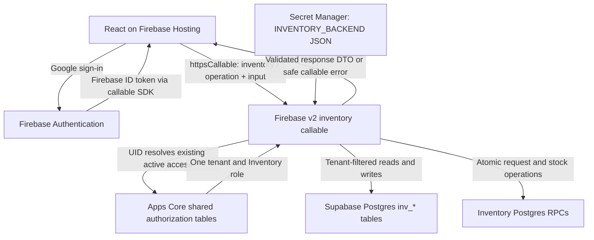

# Single Inventory Cloud Function architecture

## Approved intent

The user approved switching React from Supabase Edge to a single Firebase v2 callable named `inventory`, modeled on the supplied Service Desk ZIP, using the independent Firebase JSON secret `INVENTORY_BACKEND`. Firebase `serviceDesk`, `SERVICE_DESK_BACKEND`, Service Desk claims and `svc_*` objects must remain untouched.

## Architecture

The callable uses Node.js 22, region `asia-southeast1`, five maximum instances, and a 60-second timeout. All operations require Firebase authentication and verified email. Supabase service credentials remain server-side. The platform verifies the Firebase token; the function additionally checks its audience against the configured Firebase project.

Apps Core remains the sole tenant and Inventory role authority: `app_users`, exactly one `tenant_memberships` record total which must be active, active `tenants` and `applications`, and explicit `membership_roles`/`app_roles`. Inventory will not require, set or remove custom claims. Browser tenant, actor, and role fields are rejected. All operational access is scoped to the resolved tenant and `inv_*` objects; shared authorization tables are read for access checks.

## Callable contract

React uses `httpsCallable(functions, "inventory")({ operation, input })`. Allowed operations are exactly `provisionInventoryAccess`, `listInventoryItems`, `updateInventoryItem`, `createMaterialRequest`, and `postStockMovement`. Existing response DTOs and React-facing API function names remain stable. Callable errors are mapped to the existing safe UI messages; infrastructure errors and secret values never reach React or logs.

The secret JSON retains the existing four fields: `url`, `secretKey`, `firebaseProjectId`, and `appKey`. Values must target Apps Core `oqsgzdkljtxtpwdzptnw`, Firebase `apps-workspace-b61a9`, and app `inventory`. The backend key is never copied into Vite environment variables. No live secret is included in this document.

## Options considered

1. Keep Supabase Edge as the React endpoint: the existing deployed architecture, but does not deliver the requested Firebase callable.
2. Restore five separate Firebase callables: reuses the old public surface, but differs from the supplied single Service Desk function.
3. One Firebase `inventory` callable dispatching existing Inventory handlers: selected by the user. Reuses tested domain validation, tenant predicates, optimistic versions and idempotency while matching the reference deployment shape.

The reference's Service Desk context RPC and `client_id` claim are not copied. Inventory uses its own current access model and tables.

## Scope and limits

The five operations exist as client API wrappers; Inventory List and access verification are currently connected to the live API. Other workflow screens still use browser demo storage. Moving that storage and every form to live Postgres is a separate implementation and is not implied by this transport switch. No database migration or role assignment is required here.

The Supabase Edge function remains available for rollback during acceptance. React must not silently fall back to it when a Firebase request fails. The old five Firebase endpoints are not re-exported or redeployed.

## Release and verification

Record existing cloud functions before deployment. Test auth rejection, malformed envelopes, unknown operations, forbidden identity fields, Viewer mutation denial, live role/membership changes, tenant filtering, optimistic conflicts, replay behavior, and redacted failures. Run all repository tests, Functions build, React type check and production build.

Deploy only `functions:inventory:inventory`, verifying this selects only codebase `inventory` and function `inventory`. Check the callable in the Firebase inventory and test anonymous rejection before publishing React. Deploy only Hosting target `app` after the function is ready. Verify Hosting serves the new bundle and Firebase `serviceDesk` metadata is unchanged. Never run a broad Functions deployment or deletion command.

If runtime secret access or deployment identity permissions are insufficient, report the exact blocker; do not grant broader account access or print the secret. Authenticated tenant A/B and role acceptance requires signed-in test users; distinguish automated security tests from actual live authenticated checks.
